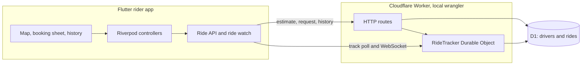
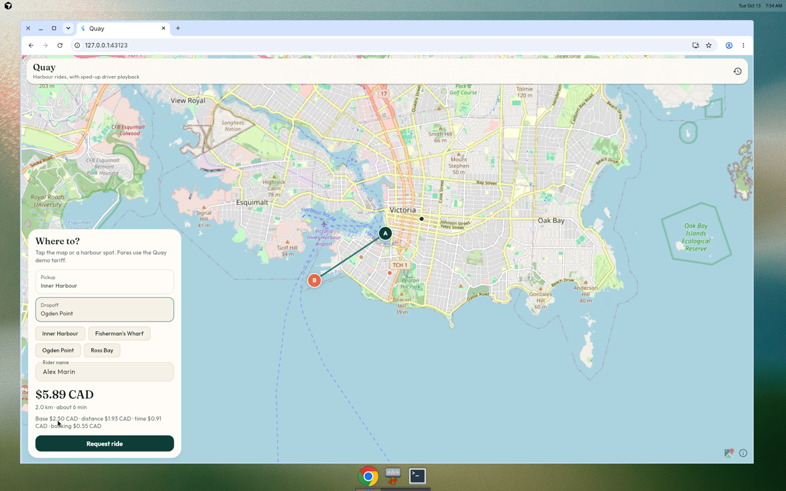
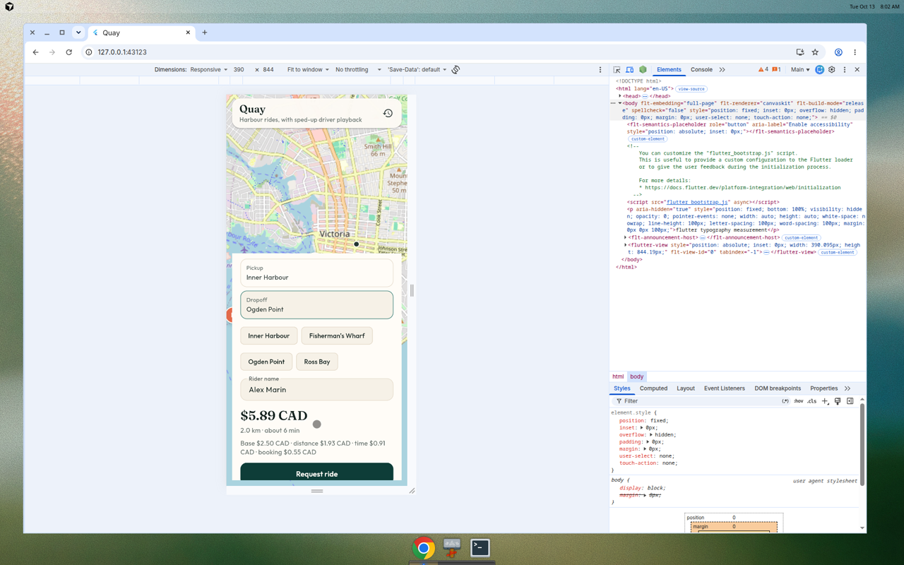
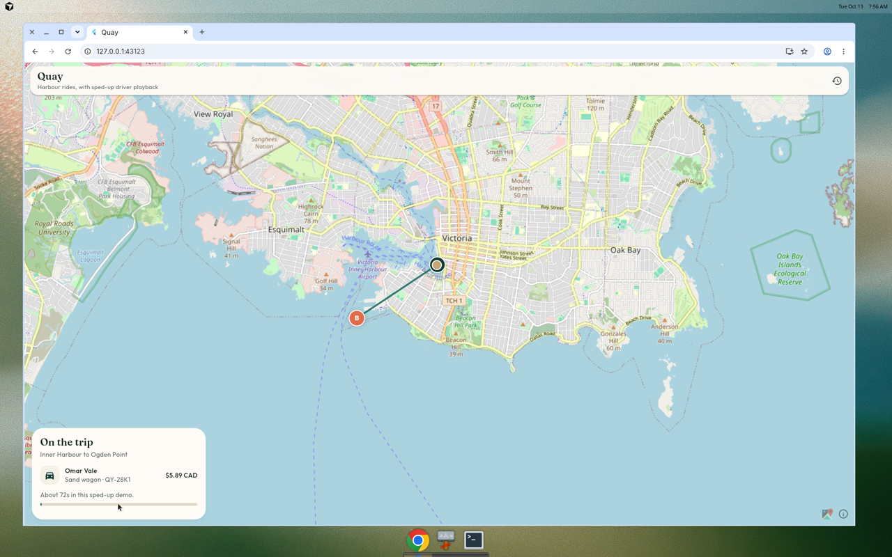
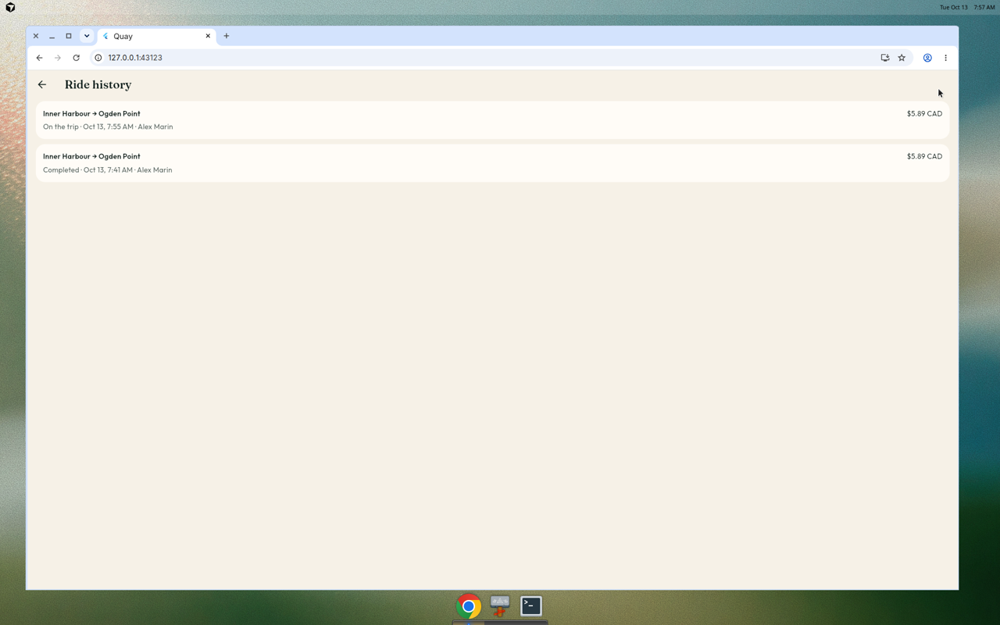

# Quay

Quay is a small, original ride-booking demo. A Flutter rider app lets you drop pickup and dropoff pins on an OpenStreetMap map, get a fare, and watch a simulated driver travel the route. A TypeScript API on Cloudflare Workers stores rides and drivers in D1 and moves each trip through a Durable Object.

The drivers, vehicles, plates, and tariff are fictional. The map is the real Victoria, BC inner harbour, used only as a backdrop. Nothing here is a production ride service, and the API has no authentication.



A ride request picks the nearest available driver and stores the trip. After that, position updates for that ride go through its `RideTracker` object, so polls and the WebSocket watch share one writer. Playback is faster than the quoted trip time so the demo finishes in well under a minute. The fare itself assumes a calmer 24 km/h.

## Fare

| Piece | Amount |
| --- | --- |
| Base | $2.50 |
| Distance | $0.95 / km |
| Time | $0.18 / min at 24 km/h |
| Booking | $0.55 |
| Minimum | $5.00 |

Quoted money is CAD. Pins closer than 30 meters are rejected.

## Screenshots

A fare from the Inner Harbour to Ogden Point:



The same booking on a narrow screen:



A simulated driver on the trip. Playback is sped up, so the marker moves within a few seconds:



Ride history:



## Quick start

You need Flutter 3.24 or newer (stable), Node.js 22, and npm. Wrangler is installed with the API dependencies. These commands stay on your machine. Do not run `wrangler deploy`.

### API

```bash
cd backend
npm install
npx wrangler d1 migrations apply quay-rides --local
npm run dev
```

The API listens on `http://127.0.0.1:8787`.

Useful routes:

| Method | Path | Purpose |
| --- | --- | --- |
| GET | `/health` | Liveness |
| GET | `/v1/drivers` | Seeded drivers |
| POST | `/v1/fares/estimate` | Fare quote |
| POST | `/v1/rides` | Assign the nearest driver and start a ride |
| GET | `/v1/rides` | History, newest first |
| GET | `/v1/rides/:id` | One ride |
| GET | `/v1/rides/:id/track` | Simulated driver position |
| GET | `/v1/rides/:id/watch` | WebSocket with the same payload |
| POST | `/v1/rides/:id/cancel` | Cancel before the trip starts |

`track` and `cancel` accept `?at=<epoch ms>` so tests can move the demo clock without waiting.

### Flutter

In another shell, with the API already running:

```bash
cd app
flutter pub get
flutter run -d chrome --dart-define=API_BASE=http://127.0.0.1:8787
```

On a phone or desktop emulator, use the same define. The default base URL is already `http://127.0.0.1:8787`.

### One-port web preview

Build the Flutter web app so it calls the API on the same origin, then serve that build and proxy the API:

```bash
cd app
flutter build web --dart-define=API_BASE=
cd ..
node scripts/preview.mjs
```

Leave `npm run dev` running. Open `http://127.0.0.1:43123`.

## Tests

```bash
cd backend && npm test && npm run typecheck
cd app && flutter analyze && flutter test
```

GitHub Actions runs those checks and `flutter build web` on every push and pull request.

## Layout

```
app/        Flutter app. Domain models, RideApi, Riverpod state, map UI.
backend/    Worker, D1 migration, fare and playback math, Vitest suite.
scripts/    Local web preview server.
```

The Flutter side keeps widgets free of HTTP. `BookingController` talks to a `RideRepository` and a `RideWatch`. Tests use fakes. The Worker keeps fare math and the playback timeline in plain functions, with D1 and the Durable Object behind them.

Outfit and Fraunces are included under the SIL Open Font License. See `app/assets/fonts/OFL-Outfit.txt` and `app/assets/fonts/OFL-Fraunces.txt`. Map tiles are © OpenStreetMap contributors.

## License

MIT. See [LICENSE](LICENSE).
